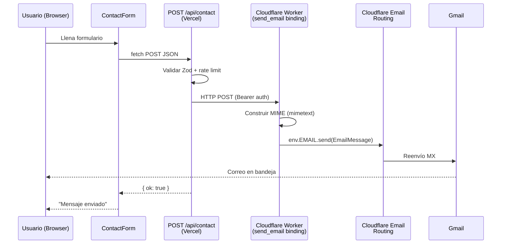

> **Estado:** Plan histórico sustituido. El PR actual usa Resend para el envío y conserva Turnstile y Durable Objects en Cloudflare. La configuración vigente está en [deployment.md](deployment.md).

# Plan de implementación — Cloudflare Email Routing + Worker

## Resumen ejecutivo

Integrar el envío de correos del formulario de contacto usando **Cloudflare** como servicio único:

- **Cloudflare Email Routing** — Recibe correos en `contacto@tudominio.dev` y los reenvía a Gmail.
- **Cloudflare Worker + binding `send_email`** — Envía correos programáticamente desde el formulario. El Worker expone un endpoint HTTP que la ruta API de Next.js invoca; el Worker construye el mensaje MIME y lo despacha a través de la infraestructura de email de Cloudflare, llegando a la dirección configurada en Email Routing.

Todo el código del lado de Next.js usa un **patrón wrapper** (`EmailAdapter`) para que cambiar de proveedor en el futuro solo requiera un archivo nuevo y una variable de entorno.

> [!IMPORTANT]
> El dominio debe estar en Cloudflare DNS. Email Routing y Email Sending (Worker binding) requieren registros MX, SPF, DKIM y DMARC que Cloudflare configura automáticamente al onboardear el dominio.

---

## Arquitectura

### Flujo completo



### Estructura de archivos (Next.js — Vercel)

```text
src/lib/contact/
├── types.ts              # EmailPayload, EmailResult, interfaz EmailAdapter
├── validation.ts         # Schema Zod + validateContact()
├── adapters/
│   ├── cloudflare.ts     # CloudflareEmailAdapter (llama al Worker via HTTP)
│   └── console.ts        # ConsoleEmailAdapter (desarrollo, log en consola)
├── provider.ts           # Factory: getEmailAdapter() → adapter según EMAIL_PROVIDER
└── rate-limit.ts         # Rate limiting por IP en memoria

src/app/api/contact/
└── route.ts              # Route handler POST
```

### Estructura del Worker (repositorio aparte o subdirectorio)

```text
workers/portfolio-contact-email/
├── wrangler.jsonc        # Configuración con send_email binding
├── src/
│   └── index.ts          # fetch handler: autenticación + envío MIME
├── package.json          # mimetext como dependencia
└── tsconfig.json
```

### Patrón wrapper — `EmailAdapter`

```typescript
// src/lib/contact/types.ts
interface EmailAdapter {
  send(payload: EmailPayload): Promise<EmailResult>;
}
```

**Para cambiar de proveedor en el futuro:**

1. Crear `src/lib/contact/adapters/nuevo-proveedor.ts` implementando `EmailAdapter`
2. Agregar un case en `provider.ts`
3. Cambiar `EMAIL_PROVIDER` en las variables de entorno

Cero cambios en formulario, ruta API ni validación.

### Archivos a crear o modificar

| Archivo                                    | Acción        | Descripción                            |
| ------------------------------------------ | ------------- | -------------------------------------- |
| `src/lib/contact/types.ts`                 | **Crear**     | Tipos e interfaz `EmailAdapter`        |
| `src/lib/contact/validation.ts`            | **Crear**     | Schema Zod, validación servidor        |
| `src/lib/contact/adapters/cloudflare.ts`   | **Crear**     | Adapter que llama al Worker HTTP       |
| `src/lib/contact/adapters/console.ts`      | **Crear**     | Adapter de desarrollo                  |
| `src/lib/contact/provider.ts`              | **Crear**     | Factory según `EMAIL_PROVIDER`         |
| `src/lib/contact/rate-limit.ts`            | **Crear**     | Rate limiting por IP                   |
| `src/app/api/contact/route.ts`             | **Crear**     | Route handler POST                     |
| `src/components/sections/contact-form.tsx` | **Modificar** | Habilitar envío, estados               |
| `messages/es.json`                         | **Modificar** | Agregar copy de estados del formulario |
| `messages/en.json`                         | **Modificar** | Agregar copy de estados del formulario |
| `.env.example`                             | **Modificar** | Agregar variables del proveedor        |
| `workers/portfolio-contact-email/`         | **Crear**     | Worker de Cloudflare                   |

---

## Fases de implementación

---

### Fase 1 — Tipos, interfaz wrapper y validación Zod

**Objetivo:** Establecer la base tipada. Sin cambios en UI ni dependencias de red.

**Dependencia nueva:** `zod` (indicado en AGENTS.md para validación de contacto).

#### 1.1 Instalar Zod

```bash
pnpm add zod
```

#### 1.2 Crear `src/lib/contact/types.ts`

Definir los tres tipos fundamentales del sistema:

```typescript
/** Datos que el formulario envía al servidor */
export interface EmailPayload {
  name: string;
  email: string;
  message: string;
}

/** Resultado de un intento de envío */
export interface EmailResult {
  success: boolean;
  /** ID del mensaje si el proveedor lo proporciona */
  messageId?: string;
  /** Error legible para logs del servidor (nunca exponer al cliente) */
  error?: string;
}

/** Contrato que todo proveedor de correo debe cumplir */
export interface EmailAdapter {
  send(payload: EmailPayload): Promise<EmailResult>;
}
```

#### 1.3 Crear `src/lib/contact/validation.ts`

Schema Zod que replica los constraints del formulario HTML (required, maxLength, minLength, email type). Función `validateContact()` que retorna datos tipados o errores por campo.

- `name`: string, trim, 1–100 chars
- `email`: string, trim, email válido, max 254 chars
- `message`: string, trim, 10–5000 chars

Los códigos de error del schema (`"required"`, `"email"`, `"tooShort"`, `"tooLong"`) deben coincidir con las keys del tipo `FormCopy["validation"]` que ya existe en `contact-form.tsx`.

#### 1.4 Verificación

- [ ] `pnpm typecheck` pasa
- [ ] `pnpm lint` pasa
- [ ] Los tipos son importables desde `@/lib/contact/types`
- [ ] Sin cambios visibles en la UI

---

### Fase 2 — Adapters y factory del proveedor

**Objetivo:** Implementar los adapters y la factory que los selecciona por variable de entorno.

#### 2.1 Crear `src/lib/contact/adapters/console.ts`

Adapter para desarrollo local. No envía correos, solo loguea en la consola del servidor Next.js.

- Implementa `EmailAdapter`
- `send()` hace `console.info(...)` con los datos (sin el mensaje completo, solo metadata) y retorna `{ success: true, messageId: "dev-<timestamp>" }`
- Es el adapter por defecto cuando `EMAIL_PROVIDER` no está configurado

#### 2.2 Crear `src/lib/contact/adapters/cloudflare.ts`

Adapter que envía un HTTP POST al Cloudflare Worker.

**Variables de entorno que lee del constructor:**

| Variable                  | Propósito                                                                                 |
| ------------------------- | ----------------------------------------------------------------------------------------- |
| `CF_WORKER_URL`           | URL del Worker desplegado (ej. `https://portfolio-contact-email.<subdomain>.workers.dev`) |
| `CF_WORKER_AUTH_SECRET`   | Token compartido entre la ruta API y el Worker para autenticación                         |
| `CONTACT_RECIPIENT_EMAIL` | Email destino (tu Gmail)                                                                  |
| `CONTACT_SENDER_DOMAIN`   | Dominio verificado en Cloudflare (ej. `tudominio.dev`)                                    |

**Comportamiento del `send()`:**

1. Envía `fetch(workerUrl, { method: "POST", headers: { Authorization: "Bearer <secret>", "Content-Type": "application/json" }, body: JSON.stringify({ to, from, replyTo, senderName, subject, body }) })`
2. Si la respuesta es `2xx` → `{ success: true }`
3. Si falla → `{ success: false, error: "<status>: <body>" }`
4. Si `fetch` lanza excepción → `{ success: false, error: "<message>" }`

**Si faltan variables de entorno**, el constructor lanza un error descriptivo listando cuáles faltan.

#### 2.3 Crear `src/lib/contact/provider.ts`

Factory que lee `EMAIL_PROVIDER` y retorna la instancia correspondiente:

| Valor de `EMAIL_PROVIDER` | Adapter                  |
| ------------------------- | ------------------------ |
| `"cloudflare"`            | `CloudflareEmailAdapter` |
| `"console"` (default)     | `ConsoleEmailAdapter`    |

Cachear la instancia en una variable de módulo para no recrearla en cada petición (mientras la instancia serverless viva).

#### 2.4 Verificación

- [ ] `pnpm typecheck` y `pnpm lint` pasan
- [ ] Sin `EMAIL_PROVIDER`, la factory retorna `ConsoleEmailAdapter`
- [ ] Con `EMAIL_PROVIDER=cloudflare` y variables faltantes, el constructor lanza error descriptivo
- [ ] Sin cambios en la UI

---

### Fase 3 — Rate limiting y ruta API

**Objetivo:** Proteger el endpoint y crear `POST /api/contact`.

#### 3.1 Crear `src/lib/contact/rate-limit.ts`

Rate limiting en memoria por IP.

**Configuración:**

- Ventana: 1 hora (60 × 60 × 1000 ms)
- Máximo: 5 peticiones por IP por ventana

**Función `checkRateLimit(ip: string)`** retorna `{ allowed: boolean; retryAfterMs?: number }`.

> [!NOTE]
> **Limitación serverless:** Un `Map` en memoria no persiste entre instancias cold-start de Vercel. Para un portafolio personal con tráfico bajo, ofrece protección parcial suficiente dentro de una instancia caliente. Documentar esta limitación con un comentario en el archivo. Si se necesita persistencia, usar Vercel KV o Upstash Redis.

#### 3.2 Crear `src/app/api/contact/route.ts`

Route handler `POST` con este flujo:

```text
1. Extraer IP de x-forwarded-for / x-real-ip / "unknown"
2. checkRateLimit(ip) → si no permitido → 429 con Retry-After header
3. Verificar Content-Type: application/json → si no → 415
4. Verificar Content-Length ≤ 16 KB → si excede → 413
5. Parsear body como JSON → si falla → 400
6. validateContact(body) → si falla → 422 con { error: "validation", fields: {...} }
7. getEmailAdapter().send(datos) → si falla → 502 con { error: "send_failed" }
8. Éxito → 200 con { ok: true }
```

**Códigos de respuesta:**

| Status | Significado                            |
| ------ | -------------------------------------- |
| `200`  | Mensaje aceptado por el proveedor      |
| `400`  | JSON inválido                          |
| `413`  | Payload demasiado grande               |
| `415`  | Content-Type incorrecto                |
| `422`  | Validación fallida (errores por campo) |
| `429`  | Rate limit excedido                    |
| `500`  | Error inesperado                       |
| `502`  | El proveedor rechazó o falló           |

**Nunca exponer** el error interno del adapter al cliente. Solo loguearlo con `console.error`.

#### 3.3 Verificación

- [ ] `pnpm typecheck` y `pnpm lint` pasan
- [ ] `pnpm build` genera la ruta `/api/contact`
- [ ] Con `EMAIL_PROVIDER=console` (default):
  - `curl -X POST localhost:3000/api/contact -H 'Content-Type: application/json' -d '{}'` → 422
  - Con datos válidos → 200 y log en consola del servidor
  - 6 peticiones rápidas desde la misma IP → 429
- [ ] Sin body → 400
- [ ] Con `Content-Type: text/plain` → 415

---

### Fase 4 — Integrar el formulario cliente

**Objetivo:** Habilitar el envío, manejar estados, conservar datos si falla.

#### 4.1 Agregar copy de estados al tipo `FormCopy`

Nuevas keys en el tipo (y en los diccionarios `messages/es.json` y `messages/en.json`):

| Key              | ES                                                  | EN                                            |
| ---------------- | --------------------------------------------------- | --------------------------------------------- |
| `submitting`     | `"Enviando mensaje…"`                               | `"Sending message…"`                          |
| `success`        | `"Mensaje enviado. Gracias por contactarme."`       | `"Message sent. Thanks for reaching out."`    |
| `errorGeneric`   | `"No se pudo enviar el mensaje. Intenta de nuevo."` | `"Could not send message. Please try again."` |
| `errorRateLimit` | `"Demasiados intentos. Espera un momento."`         | `"Too many attempts. Please wait a moment."`  |

**Eliminar** la key `providerPending` y su mensaje de "proveedor pendiente".

#### 4.2 Modificar `contact-form.tsx`

Cambios principales:

1. **Agregar estado** `formStatus: "idle" | "submitting" | "success" | "error"` con `useState`
2. **Reemplazar** `onSubmit={(e) => e.preventDefault()}` con handler real:
   - Validar todos los campos en cliente (reutilizar `validateField` existente en cada campo)
   - Si hay errores cliente → no enviar
   - Transicionar a `"submitting"`
   - `fetch("/api/contact", { method: "POST", headers: { "Content-Type": "application/json" }, body: JSON.stringify({ name, email, message }) })`
   - Si `200` → `"success"`, limpiar formulario
   - Si `429` → `"error"` con `errorRateLimit`
   - Si otro error → `"error"` con `errorGeneric`
   - **Conservar datos** del formulario si falla (no limpiar)
3. **Habilitar el `Button`:**
   - Quitar `disabled` y `className={styles.disabledButton}`
   - Usar `disabled` solo durante `"submitting"`
   - Usar prop `loading` del Button de Iconiq durante `"submitting"` para feedback visual
   - Mantener `disableRipple` y `type="submit"`
4. **Actualizar la región `role="status"`** con el mensaje correspondiente al estado actual:
   - `"idle"` → nada visible (o texto neutro)
   - `"submitting"` → `copy.submitting`
   - `"success"` → `copy.success`
   - `"error"` → `copy.errorGeneric` o `copy.errorRateLimit`
5. **Prevenir doble envío:** deshabilitar el botón y los campos durante `"submitting"`
6. **Después de `"success"`:** mostrar el mensaje de éxito. Opcionalmente permitir enviar otro mensaje (volver a `"idle"` tras unos segundos o con un enlace).

#### 4.3 Verificación

- [ ] `pnpm typecheck` y `pnpm lint` pasan
- [ ] Con `EMAIL_PROVIDER=console`:
  - Envío exitoso → mensaje de éxito, formulario se limpia
  - Botón muestra estado `loading` durante el envío
- [ ] Con servidor detenido o error forzado → mensaje de error, formulario conserva datos
- [ ] Navegación con `Tab` entre campos funcional
- [ ] `Enter` en un campo envía el formulario (submit nativo)
- [ ] 6 envíos rápidos → mensaje de rate limit
- [ ] La región `role="status"` actualiza el mensaje accesiblemente (`aria-live`)
- [ ] Tests Playwright existentes del formulario actualizados para los nuevos estados

---

### Fase 5 — Cloudflare Worker (infraestructura externa)

**Objetivo:** Crear y desplegar el Worker que envía emails a través del binding `send_email` de Cloudflare.

> [!WARNING]
> Esta fase involucra el dashboard de Cloudflare y CLI de Wrangler. El dominio debe estar en Cloudflare DNS. Los pasos de DNS y onboarding son manuales.

#### 5.1 Configurar Email Routing (recepción)

1. Dashboard → seleccionar dominio → **Email** → **Email Routing** → Habilitar
2. Agregar regla de enrutamiento:
   - Dirección personalizada: `contacto@tudominio.dev`
   - Destino: tu dirección Gmail
3. Verificar la dirección Gmail destino (Cloudflare envía correo de confirmación)
4. Cloudflare configura automáticamente los registros MX y SPF:

```text
MX   tudominio.dev → route1.mx.cloudflare.net (prioridad 69)
MX   tudominio.dev → route2.mx.cloudflare.net (prioridad 12)
MX   tudominio.dev → route3.mx.cloudflare.net (prioridad 36)
TXT  tudominio.dev → "v=spf1 include:_spf.mx.cloudflare.net ~all"
```

5. Probar enviando un correo externo a `contacto@tudominio.dev` → debe llegar a Gmail

#### 5.2 Onboardear dominio para Email Sending

1. Dashboard → **Compute** → **Email Service** → **Email Sending**
2. Click **Onboard Domain** → seleccionar `tudominio.dev`
3. Cloudflare provisiona automáticamente:
   - Subdominio `cf-bounce.tudominio.dev` para bounce handling
   - Registros SPF en el subdominio de bounce
   - Registros DKIM (`cf-bounce._domainkey.tudominio.dev`)
4. Agregar registro DMARC si no existe:

```text
TXT  _dmarc.tudominio.dev → "v=DMARC1; p=none; rua=mailto:tu-email@gmail.com"
```

5. Esperar propagación DNS (5–15 minutos en Cloudflare, hasta 24h global)

#### 5.3 Crear el Worker

**Prerequisitos:** `npm install -g wrangler` y autenticarse con `wrangler login`.

**Inicializar proyecto:**

```bash
mkdir -p workers/portfolio-contact-email
cd workers/portfolio-contact-email
npm init -y
npm install mimetext
npm install -D wrangler typescript @cloudflare/workers-types
```

**`wrangler.jsonc`:**

```jsonc
{
  "$schema": "./node_modules/wrangler/config-schema.json",
  "name": "portfolio-contact-email",
  "main": "src/index.ts",
  "compatibility_date": "2026-11-08",
  "send_email": [
    {
      "name": "EMAIL",
      "destination_address": "tu-email@gmail.com",
    },
  ],
}
```

> [!NOTE]
> `destination_address` restringe el binding a enviar solo a esa dirección. Es más seguro que dejarlo abierto.

**`src/index.ts`:**

```typescript
import { EmailMessage } from "cloudflare:email";
import { createMimeMessage } from "mimetext";

interface Env {
  EMAIL: { send(message: EmailMessage): Promise<void> };
  AUTH_SECRET: string;
}

interface ContactPayload {
  to: string;
  from: string;
  replyTo: string;
  senderName: string;
  subject: string;
  body: string;
}

export default {
  async fetch(request: Request, env: Env): Promise<Response> {
    // Solo POST
    if (request.method !== "POST") {
      return new Response("Method not allowed", { status: 405 });
    }

    // CORS preflight (si es necesario)
    if (request.method === "OPTIONS") {
      return new Response(null, { status: 204 });
    }

    // Autenticación Bearer
    const auth = request.headers.get("Authorization");
    if (auth !== `Bearer ${env.AUTH_SECRET}`) {
      return new Response("Unauthorized", { status: 401 });
    }

    try {
      const payload: ContactPayload = await request.json();

      if (!payload.to || !payload.from || !payload.body || !payload.subject) {
        return jsonResponse({ error: "Missing required fields" }, 400);
      }

      // Construir mensaje MIME
      const msg = createMimeMessage();
      msg.setSender({
        name: payload.senderName || "Portafolio",
        addr: payload.from,
      });
      msg.setRecipient(payload.to);
      msg.setSubject(payload.subject);
      msg.setHeader("Reply-To", payload.replyTo);
      msg.addMessage({ contentType: "text/plain", data: payload.body });

      // Enviar vía binding
      const emailMessage = new EmailMessage(
        payload.from,
        payload.to,
        msg.asRaw(),
      );
      await env.EMAIL.send(emailMessage);

      return jsonResponse({ ok: true }, 200);
    } catch (err: unknown) {
      const message = err instanceof Error ? err.message : "Unknown error";
      console.error("Worker email send failed:", message);
      return jsonResponse({ error: "Failed to send email" }, 500);
    }
  },
};

function jsonResponse(data: Record<string, unknown>, status: number): Response {
  return new Response(JSON.stringify(data), {
    status,
    headers: { "Content-Type": "application/json" },
  });
}
```

#### 5.4 Configurar secret del Worker

```bash
cd workers/portfolio-contact-email

# Generar un token aleatorio
openssl rand -hex 32
# Copiar el resultado

# Guardarlo como secret en el Worker
wrangler secret put AUTH_SECRET
# Pegar el token cuando lo pida
```

Este mismo valor se configura como `CF_WORKER_AUTH_SECRET` en Vercel.

#### 5.5 Desplegar el Worker

```bash
wrangler deploy
```

Anotar la URL resultante: `https://portfolio-contact-email.<subdomain>.workers.dev`

#### 5.6 Probar el Worker directamente

```bash
curl -X POST https://portfolio-contact-email.<subdomain>.workers.dev \
  -H "Content-Type: application/json" \
  -H "Authorization: Bearer <AUTH_SECRET>" \
  -d '{
    "to": "tu-email@gmail.com",
    "from": "contacto@tudominio.dev",
    "replyTo": "test@example.com",
    "senderName": "Test",
    "subject": "Test desde Worker",
    "body": "Este es un correo de prueba."
  }'
```

Verificar que el correo llega a Gmail con `Reply-To: test@example.com`.

#### 5.7 Verificación

- [ ] Email Routing activo y reenvía correos externos a Gmail
- [ ] Worker desplegado y responde 401 sin auth, 200 con auth válido
- [ ] Correo de prueba llega a Gmail desde el Worker
- [ ] `Reply-To` funciona correctamente
- [ ] SPF/DKIM/DMARC pasan (revisar headers del correo en Gmail → "Show original")

---

### Fase 6 — Variables de entorno y despliegue

**Objetivo:** Conectar la ruta API de Vercel con el Worker de Cloudflare en producción.

#### 6.1 Actualizar `.env.example`

```env
# Public canonical origin
SITE_URL=https://itsdraggodeidad-portfolio.vercel.app

# --- Contact email provider ---
# Opciones: "console" (dev/default), "cloudflare"
EMAIL_PROVIDER=console

# Cloudflare Worker adapter (solo con EMAIL_PROVIDER=cloudflare)
CF_WORKER_URL=
CF_WORKER_AUTH_SECRET=
CONTACT_RECIPIENT_EMAIL=
CONTACT_SENDER_DOMAIN=
```

#### 6.2 Configurar en Vercel (producción)

Dashboard → Project (`itsdraggodeidad`) → Settings → Environment Variables:

| Variable                  | Valor                                                     | Entorno    |
| ------------------------- | --------------------------------------------------------- | ---------- |
| `EMAIL_PROVIDER`          | `cloudflare`                                              | Production |
| `CF_WORKER_URL`           | `https://portfolio-contact-email.<subdomain>.workers.dev` | Production |
| `CF_WORKER_AUTH_SECRET`   | El token generado con `openssl rand -hex 32`              | Production |
| `CONTACT_RECIPIENT_EMAIL` | Tu Gmail                                                  | Production |
| `CONTACT_SENDER_DOMAIN`   | `tudominio.dev`                                           | Production |

> [!CAUTION]
> **Nunca** agregar `CF_WORKER_AUTH_SECRET` a Git. Nunca configurar `EMAIL_PROVIDER=cloudflare` en preview/development (usa `console`).

#### 6.3 GitHub Actions

- El CI **no necesita** variables de email — son runtime only
- Los tests Playwright usan `EMAIL_PROVIDER=console` implícitamente (variable no configurada = console)
- No agregar secretos de email a GitHub Actions

#### 6.4 Redesplegar

```bash
# Opción A: push a main (pipeline existente)
git push origin main

# Opción B: deploy manual con CLI
vercel --prod
```

#### 6.5 Verificación

- [ ] En producción: enviar formulario → correo llega a Gmail
- [ ] `Reply-To` contiene el email del visitante
- [ ] El asunto es `"Portafolio: mensaje de <nombre>"`
- [ ] Rate limit: 6to envío → mensaje de error en UI
- [ ] Error de red / Worker caído → mensaje de error, formulario conserva datos
- [ ] En desarrollo (`pnpm dev`) → formulario envía a consola, no a Cloudflare

---

### Fase 7 — Tests y documentación

**Objetivo:** Tests automatizados y documentación final.

#### 7.1 Tests Playwright

Actualizar/crear tests del formulario con `page.route()` para interceptar `/api/contact`:

| Test                | Mock de `/api/contact`                                | Verifica                                                                                            |
| ------------------- | ----------------------------------------------------- | --------------------------------------------------------------------------------------------------- |
| Envío exitoso       | Responde `200 { ok: true }`                           | Transición idle → submitting → success. Formulario se limpia. Región `role="status"` muestra éxito. |
| Error del servidor  | Responde `502 { error: "send_failed" }`               | Mensaje de error visible. Formulario conserva datos.                                                |
| Rate limit          | Responde `429 { error: "rate_limit" }`                | Mensaje de rate limit visible.                                                                      |
| Validación servidor | Responde `422 { error: "validation", fields: {...} }` | Errores por campo visibles.                                                                         |
| Doble click         | Interceptar y demorar respuesta                       | Botón disabled durante submitting. No se envía dos veces.                                           |

> [!NOTE]
> Nunca enviar correos reales en tests. Usar `page.route()` para todas las intercepciones.

#### 7.2 Documentar

- Agregar sección en `docs/implementation-plan.md` con resumen de la integración
- Actualizar `docs/component-sources.md` si se agrega Zod como dependencia
- Actualizar `docs/deployment.md` con las variables de email y el Worker

#### 7.3 Verificación final

- [ ] `pnpm lint` pasa
- [ ] `pnpm typecheck` pasa
- [ ] `pnpm build` pasa
- [ ] `pnpm test:e2e` pasa (incluidos tests nuevos de contacto)
- [ ] Formulario funcional en producción
- [ ] Documentación actualizada

---

## Resumen de variables de entorno

| Variable                  | Dónde                           | Propósito                                 |
| ------------------------- | ------------------------------- | ----------------------------------------- |
| `EMAIL_PROVIDER`          | `.env` / Vercel                 | `"console"` (dev) o `"cloudflare"` (prod) |
| `CF_WORKER_URL`           | Vercel (prod)                   | URL del Worker desplegado                 |
| `CF_WORKER_AUTH_SECRET`   | Vercel (prod) + Wrangler secret | Token compartido para autenticación       |
| `CONTACT_RECIPIENT_EMAIL` | Vercel (prod)                   | Gmail que recibe los mensajes             |
| `CONTACT_SENDER_DOMAIN`   | Vercel (prod)                   | Dominio verificado en Cloudflare          |
| `AUTH_SECRET`             | Wrangler secret (Worker)        | Mismo valor que `CF_WORKER_AUTH_SECRET`   |

## Decisiones de diseño

| Decisión                                   | Justificación                                                                                                              |
| ------------------------------------------ | -------------------------------------------------------------------------------------------------------------------------- |
| Cloudflare Worker con `send_email` binding | Infraestructura nativa de Cloudflare, sin servicios terceros. El dominio ya está en CF. SPF/DKIM/DMARC gestionados por CF. |
| Patrón adapter/factory                     | AGENTS.md pide no acoplar a un proveedor. Un archivo + env var para cambiar.                                               |
| `mimetext` en el Worker                    | Librería ligera para construir MIME. Evita armar headers a mano.                                                           |
| HTTP entre Vercel y Worker                 | Vercel no puede usar bindings de CF. El Worker expone un endpoint autenticado.                                             |
| Bearer token como auth                     | Simple, sin estado, suficiente para un endpoint privado entre servicios propios.                                           |
| `destination_address` en el binding        | Restringe el Worker a enviar solo al Gmail configurado. Previene abuso si el secret se filtra.                             |
| Zod en servidor                            | Validación duplicada (cliente HTML + servidor Zod) es estándar de seguridad.                                               |
| Rate limit en memoria                      | Suficiente para portafolio personal. Documentar limitación serverless.                                                     |
| `fetch` nativo, sin SDK                    | La API del Worker es un POST HTTP simple. Sin dependencias extras en Next.js.                                              |
| Console adapter como default               | Sin configuración = no envía correos reales. Seguro para desarrollo.                                                       |

## Limitaciones conocidas

1. **Rate limit no persiste entre instancias serverless.** Protección parcial dentro de instancias calientes. Para persistencia, usar Vercel KV o Upstash Redis.
2. **`EmailResult.success` ≠ entrega garantizada.** Indica que Cloudflare aceptó el mensaje, no que llegó a la bandeja.
3. **No hay respuestas salientes desde el dominio.** Email Routing solo reenvía. Para responder, usar Gmail directamente; `Reply-To` lo facilita.
4. **El Worker es un componente externo.** Tiene su propio deploy, monitoring y logs (en Cloudflare Dashboard → Workers → Logs). No se despliega con el pipeline de GitHub Actions del portafolio.
5. **DNS propagation.** Tras onboardear el dominio, los registros SPF/DKIM pueden tardar hasta 24h en propagarse globalmente.

## Extensibilidad futura

Para agregar un proveedor alternativo (ejemplo: Resend):

```text
1. Crear src/lib/contact/adapters/resend.ts implementando EmailAdapter
2. Agregar "resend" como case en provider.ts
3. Agregar RESEND_API_KEY y CONTACT_SENDER_ADDRESS a .env.example
4. Configurar en Vercel: EMAIL_PROVIDER=resend + variables
5. Sin cambios en formulario, ruta API ni validación
```
